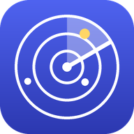

# StudiRadar 📡

Dein persönlicher Uni-Überblick für die **Uni zu Köln**: StudiRadar läuft auf deinem
Raspberry Pi, durchsucht regelmäßig **ILIAS** (und auf Wunsch **KLIPS 2.0**) und schickt dir
Neues als **Push-Nachricht aufs Handy**: neue Dateien, Übungsblätter, Abgabefristen,
Forenbeiträge, Tests, Prüfungstermine. Eigene Aufgaben kannst du dazuschreiben.

<p align="center"></p>

## Was die App kann

| Bereich | Wie | Automatisch? |
|---|---|---|
| ILIAS: neue/aktualisierte Dateien, Ordner, Weblinks, Videos | Login + alle Kurse/Gruppen durchsuchen | ✅ stündlich |
| ILIAS: Übungen mit Abgabeterminen (+ ob schon abgegeben) | Übungsseiten auslesen | ✅ |
| ILIAS: Tests mit Zugangsende, Foren mit neuen Beiträgen, Sitzungstermine | Kursseiten | ✅ |
| ILIAS-Kalender (alle Fristen & Termine) | Kalender-Abo-Link | ✅ sehr zuverlässig |
| KLIPS-Kalender (Stundenplan, Prüfungstermine) | Kalender-Abo-Link | ✅ ohne Duo |
| KLIPS: Noten, Prüfungsanmeldungen | Login mit Duo-Bestätigung | ⚠️ halbautomatisch, s.u. |
| Eigene Aufgaben mit/ohne Datum | in der App | – |
| Erinnerungen 72 h / 24 h / 3 h vor Fristen, Tageszusammenfassung 7:30 | Push | ✅ |

Beim **ersten Abruf** merkt sich StudiRadar nur den aktuellen Stand (keine Flut an Nachrichten).
Ab dann wird alles Neue gemeldet. Mehrere Neuigkeiten werden zu einer Nachricht zusammengefasst,
nachts (23–7 Uhr) wird gesammelt und morgens nachgeliefert.

### Warum KLIPS „halbautomatisch“?

Seit Dezember 2025 verlangt KLIPS eine **Cisco-Duo-Bestätigung**. Die lässt sich nicht (und soll
sich nicht) umgehen. So läuft es:

1. Du tippst in der App auf **„KLIPS jetzt abrufen“**.
2. Der Pi meldet sich an; die Duo-Nummer erscheint **in der App und als Push**.
3. Du gibst sie in **Duo Mobile** ein. StudiRadar klickt „Ja, das ist mein Gerät“ – damit merkt
   Duo den Pi ca. **9 Stunden** lang.
4. In dieser Zeit laufen die automatischen Abrufe (Standard 8:00 und 18:00) ohne dich. Braucht
   KLIPS dich wieder, kommt höchstens eine Erinnerung pro Tag.

Tipp: Für Termine und Prüfungsdaten reicht oft schon der **KLIPS-Kalender-Abo-Link** – ganz ohne Duo.

ILIAS ist laut ITCC nicht durch Duo geschützt und läuft deshalb voll automatisch.

---

## Installation auf dem Raspberry Pi 3B+

Empfohlen: **Raspberry Pi OS (64-bit) Lite**. Prüfen mit `uname -m` → `aarch64`.
(32-bit geht auch, dann aber ohne KLIPS-Login.)

```bash
git clone https://github.com/Justwiss/Meet-Match-Catch.git studiradar
cd studiradar
./deploy/install.sh            # ohne KLIPS-Login
# oder
./deploy/install.sh --klips    # mit Chromium für KLIPS (64-bit nötig)
```

Dann die Konfiguration ausfüllen:

```bash
nano config.toml
```

Mindestens: `[app] password` (Passwort für die App), `[ilias] username` / `password`.
Sehr empfehlenswert: die beiden **Kalender-Abo-Links** (`ical_url`):

- **ILIAS:** Dashboard → Kalender → „Abonnieren“ (bzw. Export) → Link kopieren
- **KLIPS:** Visitenkarte → Kalender → „Abonnieren“ → Link kopieren

Testen und starten:

```bash
.venv/bin/python -m studiradar login ilias     # zeigt deine Kurse, wenn der Login klappt
.venv/bin/python -m studiradar sync ilias      # erster Abruf (merkt sich den Stand)
sudo systemctl start studiradar
journalctl -u studiradar -f                    # Logs
```

### Zugriff vom Handy mit HTTPS (Tailscale)

Push-Nachrichten funktionieren nur über **HTTPS**. Am einfachsten (kostenlos, ohne Portfreigabe
am Router) geht das mit [Tailscale](https://tailscale.com):

```bash
curl -fsSL https://tailscale.com/install.sh | sh
sudo tailscale up
sudo tailscale serve --bg 8080
```

1. In der Tailscale-Verwaltung (login.tailscale.com → DNS) **MagicDNS** und **HTTPS-Zertifikate** aktivieren.
2. `tailscale serve status` zeigt deine Adresse, z.B. `https://raspberrypi.tail1234.ts.net`.
3. Auf dem Handy die **Tailscale-App** installieren und mit demselben Konto anmelden.
4. Adresse im Browser öffnen, mit deinem App-Passwort anmelden.
5. **Installieren:**
   - **iPhone (Safari):** Teilen → „Zum Home-Bildschirm“. Push geht auf dem iPhone *nur* so (ab iOS 16.4).
   - **Android (Chrome):** Menü → „App installieren“.
6. In der App auf **„Benachrichtigungen aktivieren“** tippen und erlauben.

Gut zu wissen: Push-Nachrichten kommen auch an, wenn Tailscale auf dem Handy gerade aus ist.
Nur zum Öffnen der App muss Tailscale an sein.

---

## Bedienung

- **Übersicht:** nächste Fristen, ungelesene Neuigkeiten, Termine der Woche
- **Neu:** alle Neuigkeiten, filterbar (Dateien, Foren, KLIPS). Antippen öffnet direkt ILIAS.
- **Fristen:** alles mit Datum, nach Dringlichkeit sortiert. Kreis antippen = erledigt.
  Abgegebene ILIAS-Übungen werden automatisch abgehakt.
- **+**: eigene Aufgabe anlegen (Datum optional). Eigene Einträge antippen zum Bearbeiten.
- **Mehr:** KLIPS-Abruf, Status der Abrufe, Push-Einstellungen.

## Kommandozeile

```bash
.venv/bin/python -m studiradar serve              # Server + Zeitplan (macht der Dienst)
.venv/bin/python -m studiradar sync ilias|ical|klips
.venv/bin/python -m studiradar login ilias
.venv/bin/python -m studiradar push-test
.venv/bin/python -m studiradar digest
.venv/bin/python -m studiradar list               # Fristen in der Konsole
```

## Wenn etwas nicht klappt

Mit `--debug` werden alle abgerufenen Seiten unter `data/debug/` gespeichert (bei KLIPS auch
Screenshots):

```bash
.venv/bin/python -m studiradar sync ilias --debug
.venv/bin/python -m studiradar sync klips --debug
```

- **ILIAS-Login schlägt fehl:** Zugangsdaten prüfen; `login_method = "shibboleth"` probieren.
- **Fristen einer Übung fehlen:** Kalender-Abo-Link eintragen – der enthält alle Übungsfristen.
- **KLIPS liest die falschen Seiten:** Seite in KLIPS im Browser öffnen, Adresse kopieren und in
  `config.toml` unter `[klips.pages]` eintragen.
- **Hinweis:** Die Erkennung der ILIAS- und KLIPS-Seiten ist robust gebaut, wurde aber ohne Zugriff
  auf die echten Uni-Seiten entwickelt. Falls etwas nicht erkannt wird: Debug-Dateien ansehen
  (Achtung, enthalten persönliche Daten) und den Parser anpassen.

## Sicherheit

- Deine Uni-Zugangsdaten liegen **nur auf dem Pi** in `config.toml` (Rechte `600`, nicht im Git).
- Die App ist durch ein eigenes Passwort geschützt und standardmäßig nur über Tailscale erreichbar.
- StudiRadar liest nur, es ändert nichts in ILIAS oder KLIPS. Abrufe sind gedrosselt
  (max. stündlich, kleine Pausen zwischen Seiten), um die Uni-Server nicht zu belasten.

## Entwicklung

```bash
python3 -m venv .venv && .venv/bin/pip install -r requirements-dev.txt
.venv/bin/python -m pytest
```

Aufbau: `studiradar/sources/` (ILIAS, KLIPS, Kalender/RSS), `engine.py` (Abrufe, Erinnerungen,
Zeitplan), `notify.py` (Web Push), `web.py` (API), `static/` (PWA ohne Build-Schritt).
